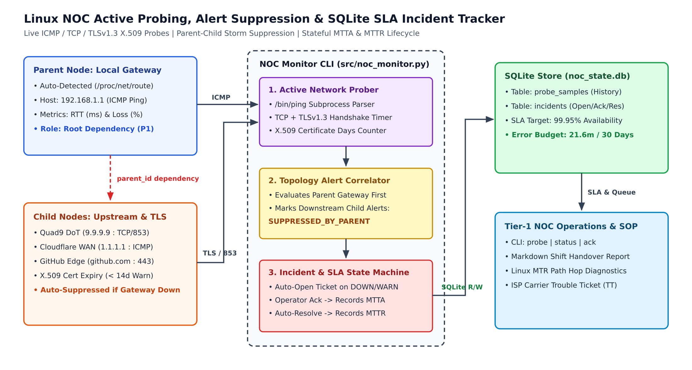

# Linux NOC Active Network Monitor & SLA Incident Tracker

A lightweight, dependency-free Python CLI tool built for **Network Operations Center (NOC)** tier-1 monitoring, parent-child alert suppression, stateful incident lifecycle tracking (`SQLite`), and shift-handover reporting on Linux.

## Architecture Overview



## What This Tool Actually Does (No Mock Data)

1. **Auto-Discovers Linux Default Gateway (`/proc/net/route`):** Automatically identifies the local first-hop router and monitors it via `/bin/ping` (`RTT` & packet loss `%`).
2. **Active TCP & TLS/X.509 Probing:** Measures real TCP/TLS handshake latency (`ms`) against critical upstream services (e.g., `9.9.9.9:853` DoT and `443` HTTPS) and extracts remaining X.509 certificate validity days to catch expiring certs before outage.
3. **Topology-Aware Alert Storm Suppression:** Evaluates parent nodes before dependent child services. If `lan-default-gw` fails, downstream WAN failures are marked `SUPPRESSED_BY_PARENT` instead of flooding operators with redundant tickets.
4. **Stateful SQLite Incident Lifecycle & SLA Math:**
   * Opens persistent incidents (`OPEN`) on probe failure or threshold breach.
   * Supports operator CLI acknowledgment (`ack`) to record real **MTTA (Mean Time to Acknowledge)**.
   * Automatically resolves incidents (`RESOLVED`) when subsequent probes recover, recording exact **MTTR (Mean Time to Resolve)** and remaining **99.95% SLA downtime budget**.
5. **Markdown Shift Handover Generator:** Exports live link telemetry, SLA compliance, and active/resolved tickets for incoming NOC shifts.

## Repository Layout

```text
noc-network-sla-monitor/
├── LICENSE
├── README.md
├── configs/
│   └── targets.json                       # Monitored hosts, thresholds & parent_id graph
├── topology/
│   ├── noc-architecture-diagram.png       # Exported architecture diagram
│   └── noc-architecture.drawio            # Editable draw.io XML source
├── runbooks/
│   └── noc-tier1-triage-sop.md            # Tier-1 NOC diagnostic commands & ISP escalation SOP
├── src/
│   ├── __init__.py
│   └── noc_monitor.py                     # Prober, correlator, SQLite incident state & CLI
└── tests/
    └── test_noc_monitor.py                # Deterministic unit tests using temp SQLite databases
```

## Real CLI Usage on Linux

```bash
git clone https://github.com/benjarong-dev/noc-network-sla-monitor.git
cd noc-network-sla-monitor

# 1. Run unit test suite (offline deterministic verification)
python3 -m unittest discover -s tests -v

# 2. Execute a live network probe cycle and update SQLite incident state
python3 -m src.noc_monitor --db ./noc_state.db probe

# 3. View current link health, active incidents, MTTA/MTTR, and SLA percentage
python3 -m src.noc_monitor --db ./noc_state.db status

# 4. Acknowledge an active incident as an on-duty NOC operator (records MTTA)
python3 -m src.noc_monitor --db ./noc_state.db ack --incident-id 1 --operator benjarong --note "Investigating WAN uplink"

# 5. Export a Markdown shift-handover summary
python3 -m src.noc_monitor --db ./noc_state.db handover --shift "Morning (08:00-16:00)"
```

## License

MIT License.
